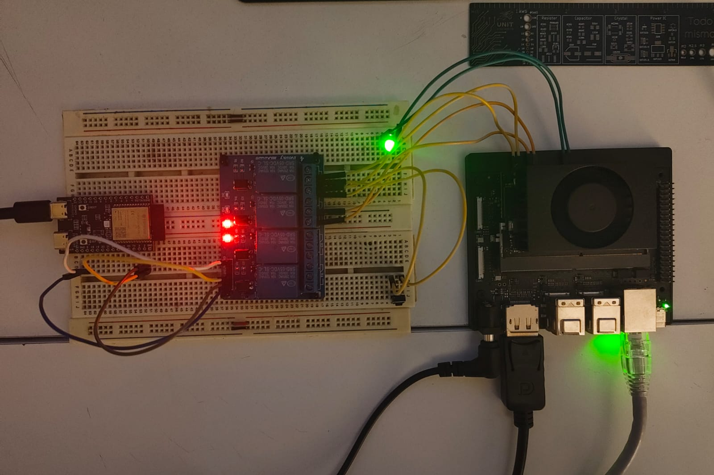
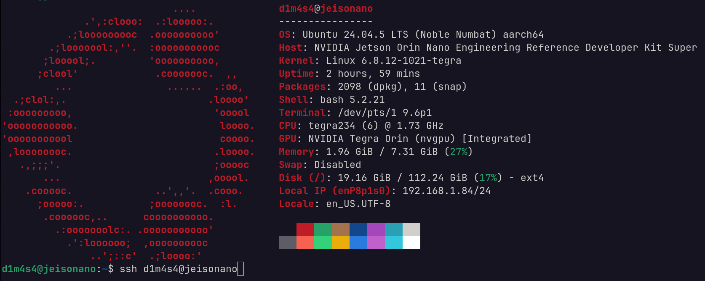
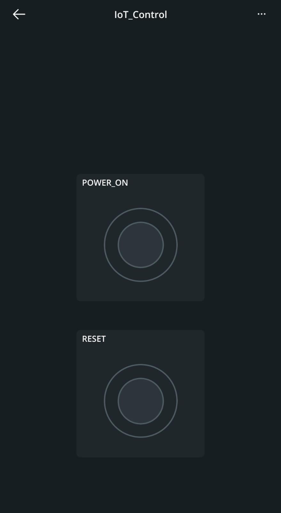
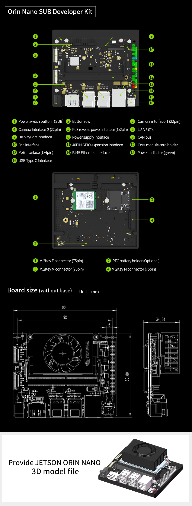

# IoT Control for a NVIDIA Jetson Orin nano 



### Uso esto con la app de arduino IoT para encender la jetson cuando no estoy en casa y me conecto usando SSH



### Tu tambien puedes usar lo para encender cualquier PC, mini PC o RasberryPi remotamente usando cualquier ESP32 o ESP8266.

### Como hacerlo:
- 1. añadir las URL del esp32 a arduino: 
	File > Preferences
	[https://espressif.github.io/arduino-esp32/package_esp32_index.json]
	(https://espressif.github.io/arduino-esp32/package_esp32_index.json)

- 2. Instalar las librerias 
	En boards manager o gestor de targetas buscar el esp32 e instalar la libreria

- 3. Seleccionar placa y puerto 
	En Tools --> Board selecciona: esp32 y en Tools --> Port selecciona: /dev/ttyACM0 o el que te salga a ti.

- 4. Codigo: 
	- pon los archivos IoT_control server.ino y thingProperties.h que estan en el repositorio.
	- crea el archivo arduino_secrets.h donde debes poner tus credenciales de arduino IoT, el SSID de tu red y la contraseña de tu red.

```c
#define SECRET_SSID ""
#define SECRET_OPTIONAL_PASS ""
#define SECRET_DEVICE_KEY ""
#define SECRET_DEVICE_LOGIN_NAME ""
```

### Arduino IoT Cloud
### 1. Preparación de la cuenta y descarga de herramientas

 (https://app.arduino.cc/)

1. Dentro del panel de Arduino IoT Cloud, ve a la pestaña **Devices** en la barra superior.
    
2. Haz clic en **Devices** o **Add Device** -> Selecciona **Third Party Device**.
    
3. Device Type: **ESP32 Dev Module** 
    
4. Dale un nombre
    
5. **MUY IMPORTANTE:** Al finalizar, el sistema te mostrará una **Secret Key** (Clave secreta). Copiala o descárgala en un PDF, la necesitarás más adelante para conectar el ESP32 a la red.
    

**2.Paso 2: Crear la Thing y las variables:**

1. Ve a la pestaña **Things** y haz clic en **Create Thing**. Ponle de nombre: Control Reles por ejemplo.
    
2. En el panel lateral derecho, en la sección **Associated Device**, selecciona la placa que creaste en el paso anterior.
    
3. En la sección **Network**, configura tus credenciales de Wi-Fi:
    
    - **SSID:** El nombre de tu red Wi-Fi de 2.4GHz.
        
    - **Password:** Tu contraseña de Wi-Fi.
        
    - **Secret Key:** Pega la clave secreta que guardaste en el Paso 1.
        
4. Ahora agrega las 2 variables asociadas a los relés haciendo clic en **Add Variable**:
    
    - **Variable 1 (Relé 1):**
        
        - Name: rele_1
            
        - Variable Type: **Switch (Boolean)**
            
        - Declaration: bool rele_1;
            
        - Variable Update Policy: _On Change_
            
    - **Variable 2 (Relé 2):**
        
        - Name: rele_2
            
        - Variable Type: **Switch (Boolean)**
            
        - Declaration: bool rele_2;
            
        - Variable Update Policy: _On Change_
            

**3.Paso 3: Crear el Dashboard (Panel de Botones):**

1. Ve a la pestaña **Dashboards** en la parte superior y haz clic en **Create Dashboard**.
    
2. Renómbralo como Panel Reles.
    
3. Haz clic en **Add** -> **Widgets** -> Selecciona **push button**.
    
    - En la configuración del widget, dale el título "POWER_ON" y presiona **Link Variable**. Selecciona la variable rele_1 de tu Thing.
        
4. Agrega un segundo widget de tipo **push button**.
    
    - Título "RESET" y vincúlalo a la variable rele_2.

### Pines:
ESP32 -->  Modulo Relee 
5V       -->  VCC
GND    -->  GND
PIN2    -->  IN1
PIN3    -->  IN2




Relee --> Jetson Botton Header o Button Socket
NO(normalmente abierto(el de arriba) -->  PWR BTN
COM(comun (el de en medio)               -->  GND

Relee 2 --> Jetson Botton Header o Button Socket
NO(normalmente abierto(el de arriba) -->  SYS RST
COM(comun (el de en medio)               -->  GND

PUENTE ENTRE : DISABLE y AUTO ON

LED + --> catodo 
LED - --> anodo


